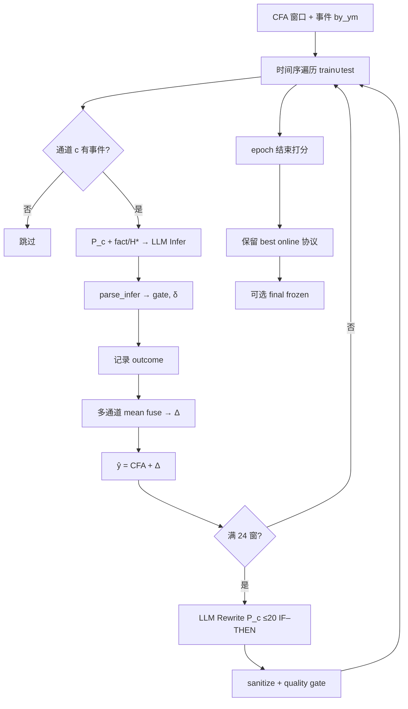

# Scheme5 v5 技术方案完整技术说明

> 面向论文写作的实现级文档。描述的是**当前显式残差定稿方案 Scheme5 v5**（`scripts/run_scheme5_v2_all.sh` → `scripts/eval_scheme5.py --improve`）。  
> 代码根目录：`MMD-TFS/`。本文尽量做到：动机清晰、符号统一、流程可复现、prompt 原文可抄。

---

## 0. 一句话概括

**Scheme5 v5** 在冻结 LLM 权重的前提下，为每个事件通道（channel）维护一份可变的自然语言协议文本 `prompt_c`（协议即记忆，无检索库）。按时间顺序遍历预测窗口：用「当前协议 + 该通道 lookback 内全部事件（fact + 机制假设 H1–H3）」做一次残差推理，得到门控的 horizon 修正向量；多通道均值融合后加到 CFA 预报上。每隔 24 个窗口，根据 hit / false_alarm / abstain 结果把协议重写为 ≤20 条 IF–THEN 经验。论文主指标是**因果在线**路径上的 `test_best_epoch_online`（相对 CFA 的 MSE 变化百分比）。

---

## 1. Motivation（为什么做 Scheme5）

### 1.1 问题背景

本仓库的时序骨干 + 文本融合基线是 **CFA（Controlled Fusion Adapter）**（论文 arXiv:2603.22372；数据来自 **Time-MMD** 多域）。CFA 已经能利用文本改善数值预报，但在「事件因果残差」设定下仍常出现：

1. **文本进了模型，但可解释的事件机制没有变成可审计的修正规则**；
2. **跨窗口经验无法积累**：每个窗口独立推理，失败案例不会变成下次可用的约束；
3. **检索式记忆**（向量库 / 相似案例）在本任务上难对齐：事件稀疏、通道异构、且容易引入跨域词污染。

因此 Stage2 显式残差线希望回答：

> 在 CFA 已经给出数值预报 \(\hat{y}^{\mathrm{CFA}}\) 的前提下，能否用 LLM **只改残差** \(\Delta\)，并让每个通道把成功/失败**写进自己的协议文本**，形成可解释、可复现的在线经验？

### 1.2 设计目标（v5 明确追求的性质）

| 目标 | v5 如何落实 |
|------|-------------|
| 残差而非重报 | 预测 \(\hat{y} = y^{\mathrm{CFA}} + \Delta\)，只优化相对 CFA 的 MSE |
| 通道隔离 | 每个 focus channel 独立协议、独立推理，禁止跨通道抄事实 |
| 协议即记忆 | 无向量检索；rewrite 直接改 `prompt_c` |
| 可解释规则 | Accumulated lessons 约束为 IF–THEN（evidence → residual up/down 或 abstain） |
| 防污染 | 域级 forbidden 词表 + sanitize + quality gate |
| 因果在线主指标 | 按时间走 train∪test；后面窗口可用前面窗口写出的经验 |
| 数值稳定 | 默认 **mean fuse × amp=1**（不做在线 amp 网格搜，避免对 test 过拟合） |

### 1.3 与仓库内其它显式方案的关系（定位）

Stage2 短名单（见 `language/stage2/README.md`）：

| 方案 | 核心想法 | 与 v5 的差异 |
|------|----------|--------------|
| **Scheme1 hier** | 事件机制汇聚 → channel → window；KEEP 预算可搜 | 机制向量偏「一次汇聚」；**不**演化自然语言协议 |
| **Scheme2 sampled dual** | 多样本 CoT + direct/indirect 双机制 + agree-gate | 强调**单窗**采样与双路径一致性；**不**做跨窗协议积累 |
| **Scheme5 v5（定稿）** | 每通道协议文本在线重写 + 全事件推理 + 均值融合 | **跨窗经验**；每通道单次推理 + 规则均值融合 |

直觉上：

- S1 提供「机制假设从哪来」（事件上的 H*）；
- S2 提供「单窗内直接/间接叙事是否要一致才敢动」；
- **S5 v5 提供「通道级可写记忆」**——把过去窗口的对错蒸馏进 ≤20 条规则，再用于未来窗口（定稿的显式主线）。

---

## 2. 参考项目 / 论文与概念谱系

> 说明：Scheme5 **不是**某一篇现成论文的逐字复现，而是本仓库 Stage2 线上的工程方案。写论文时建议把它表述为：**在 CFA 残差设定下，结合「文本作为可进化记忆」与「事件机制提示」的在线协议学习**。下列工作是概念近邻，便于 Related Work 对齐。

### 2.1 直接依赖（本仓库 / 数据 / 基线）

1. **CFA — Controlled Fusion Adapter**  
   - 引用：`arXiv:2603.22372`（仓库 README）  
   - 角色：给出数值预报 \(y^{\mathrm{CFA}}\)；Scheme5 **不改** CFA 权重，只加残差 \(\Delta\)。

2. **Time-MMD**  
   - 多域多模态时序基准；本仓库 domains：traffic / agriculture / economy / energy / public_health / security / social_good。  
   - Scheme5 的「通道」「事件」「残差语义」均按域配置（`language/stage2/profiles.py` + `scheme5_seeds.py`）。

3. **本仓库 Stage1 / Scheme1 事件管线**  
   - 事件抽取与机制假设（fact + mechanisms）写入 `events.jsonl` / Scheme1 cache。  
   - Scheme5 **推理时重新读事件文本**；机制行只作 **HINT**，不直接把 Scheme1 的数值 \(\Delta\) 当答案。

### 2.2 方法学近邻（建议在论文中讨论）

| 方向 | 代表工作（概念） | 与 Scheme5 v5 的对应 / 差异 |
|------|------------------|-----------------------------|
| 语言作为智能体记忆 | Generative Agents 等「可读写记忆」 | 我们把记忆压成 **每通道一份协议**，不是长对话轨迹库 |
| 反思式自我改进 | Reflexion 等 | 我们用 **结构化 outcome（hit/FA/abstain）** 驱动周期性 rewrite，而非自由反思段落 |
| 经验蒸馏为规则 | ExpeL 等「成功轨迹→insights」 | 我们强制 **IF–THEN ≤20**，并做 forbidden / meta-leak 清洗 |
| 提示优化 | ProTeGi / TextGrad 等（仓库 third_party 有相关代码） | **v5 未接入**自动提示梯度；LLM **权重冻结**，只改协议文本 |
| 双路径因果叙事 | 本仓库 Scheme2 | v5 为**每通道单次推理**；双路径 agree-gate 仅出现在 Scheme2，不进入 S5 定稿 |

### 2.3 Motivation 合成表述（可直接改写入论文）

> CFA 已提供强数值预报，但事件驱动的残差修正需要：（i）通道级因果隔离；（ii）可解释且可积累的经验；（iii）避免检索噪声与跨域词污染。Scheme5 将「通道协议文本」视为唯一可进化记忆，在冻结 LLM 下用在线 outcome 周期性重写 IF–THEN 规则，并用门控 horizon bias 产生加性残差，从而在因果时间序上改进相对 CFA 的预报误差。

---

## 3. 问题形式化

### 3.1 窗口与符号

对每个预测窗口 \(w\)：

- lookback 月份序列：\(m_1,\ldots,m_L\)（末月为 origin）
- 预报地平线长度：\(H\)（常见 \(H=6\)）
- 真值未来：\(y_w \in \mathbb{R}^H\)
- CFA 预报：\(c_w \in \mathbb{R}^H\)
- 残差（标量摘要，用于标签符号）：  
  \[
  r_w = \mathrm{mean}(y_w - c_w),\quad
  \mathrm{sign}(r_w)\in\{-1,0,+1\}
  \]

Focus 通道集合：\(\mathcal{C}\)（如 traffic 约 11 个：weather, fuel, holiday, …）。

每个通道 \(c\) 维护状态：

- 协议文本 \(P_c\)（即 `prompt_c`）
- 版本 \(v_c\)
- 近期 outcome 缓冲 \(\mathcal{O}_c\)
- 计数 \(n^{\mathrm{infer}}_c, n^{\mathrm{success}}_c\)

### 3.2 预测

\[
\hat{y}_w = c_w + \Delta_w,\qquad
\Delta_w = \mathrm{Fuse}\big(\{\delta_{w,c}\}_{c\in\mathcal{C}}\big)
\]

v5 默认：

\[
\Delta_w = \mathrm{mean}\{\delta_{w,c}: \mathrm{gate}_{w,c}=1,\ \|\delta_{w,c}\|_1>0\}
\]

（无活跃通道则 \(\Delta_w=\mathbf{0}\)；再乘全局 `soft_amp_scale=1` / `fixed_amp=1`。）

### 3.3 评价指标

对 test 子集：

\[
\mathrm{MSE}_0 = \mathrm{mean}\|c_w - y_w\|^2,\quad
\mathrm{MSE}_5 = \mathrm{mean}\|\hat{y}_w - y_w\|^2
\]

\[
\mathrm{rel\_pct} = \frac{\mathrm{MSE}_5 - \mathrm{MSE}_0}{\mathrm{MSE}_0}\times 100
\]

**越小越好**（负值表示相对 CFA 改善）。  
**论文主指标**：`test_best_epoch_online.rel_pct`。  
**次要 / 部署消融**：`test_final_frozen`（冻结协议后对 test 再推理一遍）。

---

## 4. 系统总览

```text
Time-MMD 数值序列
        │
        ▼
   CFA 预报 c_w          事件库 by_ym (fact + mechanisms)
        │                         │
        └──────────┬──────────────┘
                   ▼
        ┌──────────────────────┐
        │  按时间排序的窗口流   │  train ∪ test（因果在线）
        └──────────┬───────────┘
                   ▼
     对每个通道 c：P_c + 全量 lookback 事件
                   ▼
            LLM Infer (JSON)
                   ▼
         parse → gate, δ_{w,c}
                   ▼
           mean fuse → Δ_w → ŷ
                   ▼
         写 outcome（hit/FA/abstain）
                   │
        每 24 窗 ──► LLM Rewrite P_c（≤20 IF–THEN）
                   │
        epoch 结束 ─► 记录 online 分数；保留 best epoch 协议快照
                   ▼
        （可选）final frozen 再 decode test
```

### 4.1 关键文件

| 角色 | 路径 |
|------|------|
| 多域启动脚本（v5） | `scripts/run_scheme5_v2_all.sh` |
| 主循环 | `scripts/eval_scheme5.py` |
| Infer / 事件格式化 / fuse / config | `language/stage2/scheme5_channel_prompt.py` |
| Outcome 清洗 / fuse 校准 / rewrite 胶水 | `language/stage2/scheme5_improve.py` |
| 域种子协议 / rewrite 模板 / sanitize | `language/stage2/scheme5_seeds.py` |
| 窗口收集 + CFA | `language/stage2/collect.py` |
| Bias 表 | `language/stage2/actions.py` |
| 域 profile | `language/stage2/profiles.py` |
| v5 结果 | `artifacts/scheme5_v5/{domain}_eval.json` |

### 4.2 v5 默认超参（与线上一致）

| 超参 | 默认值 | 含义 |
|------|--------|------|
| `n_epochs` | 2 | 整段时间序重复遍数 |
| `rewrite_every` | 24 | 每处理 24 窗触发一次协议重写 |
| `wave` | 48 | LLM 并发批大小 |
| `cache_tag` | `s5v5`（improve 后目录为 `s5v5_improve`） | 缓存隔离 |
| `--improve` | 开 | 域种子 + 清洗 rewrite + 质量门 |
| `max_lessons` | 20 | Accumulated lessons 上限 |
| `dead_sr` | **0** | 不按成功率静音通道 |
| `fixed_amp` | **1.0** | 固定幅度，不做 amp 搜索 |
| `pick_epoch` | **best** | final 用 online test 最好的那一 epoch 协议 |
| infer temperature | 0.0 | 确定性推理 |
| rewrite temperature | 0.3 | 允许规则改写多样性 |
| `max_tokens_infer` / `rewrite` | 1024 / 2048 | （可由 llm_runtime 覆盖） |
| outcome 缓冲 | 最近 80 条，截断至 3500 字符 | 喂给 rewrite |
| protocol 长度 | ≤4800 字符（improve） | `_trim_protocol` |

---

## 5. 数据与前置：窗口如何构造

### 5.1 `collect_rows`

对每个域：

1. 读 `events.jsonl` → `by_ym[YYYY-MM] = [event, …]`  
2. 解析 Stage1 CFA candidate → 得到每窗 `yt`（真值）、`yc`（CFA）  
3. 组装 row：`wid`, `months`, `origin`, `yt`, `yc`, …  
4. `attach_scheme1(..., fill_missing=False)`：只挂已有 Scheme1 cache（**不**在本路径新填机制）。  
   **注意**：Scheme5 的 \(\Delta\) **不直接使用** Scheme1 数值向量；推理重新吃事件文本。

### 5.2 事件在 Scheme5 中的序列化：`format_channel_events`

对 lookback 每个月、属于通道 \(c\) 的**全部**事件（不做 top-k 丢弃）：

```text
[YYYY-MM/E{i}] lag={lag} fact: {fact_text 截断至 140 字}
  H1[{plausibility}→{vmt_effect}]: {mechanism_chain 截断至 100 字}
  H2[...]
  H3[...]
```

- `lag`：相对 origin 的月滞后（origin 月 lag=0）  
- `mechanisms` 为空时，用 `mechanism_chain` / `vmt_effect` 合成一条  
- `vmt_effect` 是遗留字段名，语义是「对**目标序列**的效应」，不限 traffic  

若该通道在 lookback 内 0 事件 → 本窗跳过该通道。

### 5.3 时间顺序（因果在线）

```text
all_rows = sort(train ∪ test, key=(origin, train先于test, wid))
```

含义：较晚窗口推理时，可以使用**更早窗口**已经 rewrite 进协议的经验。  
这是论文主设定；同时意味着「test 段协议可能已见过更早 test 窗的 outcome」——文档/脚本明确把这叫 **streaming / online primary**，把 `final_frozen` 当作冻结部署消融，而不是主叙事。

---

## 6. 通道协议 \(P_c\) 的结构

冷启动由 `scheme5_seeds.seed_prompt(channel, domain=...)` 生成。结构固定：

1. **Header**：`CHANNEL ASSISTANT PROTOCOL — {channel}`  
2. **Domain / Period / Target / Expert role**  
3. **Residual definition**（域相关：正负残差含义）  
4. **This channel's role**（一句话）  
5. **Standing rules**（不可轻易改掉的硬约束 + forbidden 词 + lessons≤20）  
6. **Prior lessons**（人工/启发式种子 IF–THEN）  
7. **Accumulated lessons**（在线学习区；初始 `(none yet)`）

### 6.1 完整种子示例（traffic / weather）

以下为代码实时渲染的原文（可直接作附录）：

```text
CHANNEL ASSISTANT PROTOCOL — weather
Domain: traffic | Period: month
Target series: U.S. monthly vehicle miles traveled (VMT)
Expert role: U.S. highway travel / mobility analyst

Residual definition:
- Residual = true VMT − CFA forecast. Positive ⇒ actual travel higher than CFA; negative ⇒ actual travel lower than CFA.
- residual>0 means: true VMT > CFA (under-forecasted travel / missed upward shock)
- residual<0 means: true VMT < CFA (over-forecasted travel / missed suppression)

This channel's role: Acute weather shocks affecting road usability / trip cancellation

Standing rules:
1) Reason ONLY from THIS channel's events; do not import other channels' facts.
2) Prefer exogenous / delayed drivers (weather, policy, fuel cost, mode shift) over restatements of VMT itself.
3) Mechanism hypotheses are HINTS for CoT — synthesize a net residual direction; do not copy them verbatim.
4) If events conflict, are local/non-national, or are meta-report noise → gate=0 (abstain).
5) Output one residual direction for the forecast horizon (or abstain). Do not invent numeric VMT levels.
6) National monthly VMT is dominated by passenger car travel; freight and transit matter only via clear substitution/scale.
7) Forbidden in lessons/reasoning: trade balance, gasoline pump price as the target, ILI, FEMA outlays, unemployment rate as the target, broiler price.
8) Accumulated lessons must stay ≤20 IF–THEN bullets (evidence → residual up/down OR abstain).

Prior lessons (domain seed — refine/merge via outcomes; do not delete the residual definition):
- IF acute national-scale storms/floods/ice cause closures or trip suppression within lag≤4 THEN residual=down
- IF weather text is seasonal baseline or historical mechanism without a current shock THEN gate=0
- IF evacuation vs closure mechanisms conflict without clear dominance THEN gate=0

Accumulated lessons (learned; rewrite over time — keep IF–THEN; merge with priors):
- (none yet — learn from outcomes)
```

其它域（economy / agriculture / …）同构，仅替换 residual 语义、forbidden、channel priors（见 `scheme5_seeds.py` 中 `_spec_*`）。

---

## 7. 算法详细流程（v5）

### 7.1 伪代码

```text
Input: domain, CFA windows, events by_ym, focus C
Init:  for c in C: P_c ← Seed(domain, c); v_c ← 0; O_c ← []; stats←0
best ← ∅

for epoch = 1 .. E:                         # E=2
  deltas ← {}
  since_rw ← 0
  for w in chronological(train ∪ test):
      # --- Prefetch（实现优化）：在 rewrite 段起点，预取本段最多 24 窗的 infer ---
      if since_rw == 0:
          PrefetchInfer(windows[w .. w+24), protocols frozen)

      acts ← {}
      for c in C:
          events_c ← FormatEvents(by_ym, months_w, c)
          if empty: continue
          text ← LLM_Infer(system=INFER_SYSTEM,
                           user=PromptInfer(P_c, events_c, c_w, ...))
          act ← ParseInfer(text, H)
          acts[c] ← act
          UpdateStats(c, act, y_w, c_w)
          O_c.append(OutcomeClean(...))

      Δ_w ← MeanFuse({act.vec : act.gate=1})
      deltas[w] ← Δ_w
      since_rw += 1

      if since_rw ≥ 24 or w is last:
          RewriteChannels(all c with O_c)   # 见 §7.4
          since_rw ← 0

  Score online train/test with mean@amp=1
  if test_rel better: best ← snapshot(protocols, deltas, epoch)

Restore protocols from best if pick_epoch=best
FinalFrozenDecode(test only)                # 次要指标
Return JSON metrics
```

### 7.2 单窗推理（核心）

对通道 \(c\)：

1. **User prompt** = 元信息 + **完整 \(P_c\)** + **该通道全部事件块** + JSON schema（见 §8）  
2. LLM 返回 JSON  
3. `parse_infer`：
   - 读 `confidence`，夹到 \([0,1]\)  
   - 规范化 `residual_dir` → `{increase, decrease, flat}`  
   - 若 dir ∈ {flat, mixed, volatile, abstain} **或** `confidence < 0.55` → **强制 gate=0**  
   - `horizon_bias[h]` 映射到数值表 `BIAS`（见下）  
   - 若缺 bias 列表：用 dir 对应 token 填满 \(H\) 维  
   - `gate=0` → \(\delta=\mathbf{0}\)；否则 \(\delta \leftarrow \delta \cdot (0.35 + 0.65\cdot\mathrm{conf})\)

**BIAS 数值表**（`language/stage2/actions.py`）：

| token | 值 |
|-------|-----|
| strong_up | +0.10 |
| up | +0.05 |
| flat / mixed / volatile | 0 |
| down | −0.05 |
| strong_down | −0.10 |
| increase / higher | +0.06 |
| decrease / lower | −0.06 |

### 7.3 通道成功判定与 Outcome

- `channel_improved`：\(\mathrm{MSE}(c_w+\delta, y_w) < \mathrm{MSE}(c_w, y_w)\)  
- `tag`：
  - `gate=0` → `abstain`
  - `gate=1` 且 improved → `hit`
  - `gate=1` 且不 improved → `false_alarm`

**喂给 rewrite 的 outcome 行（v5 improve）**——**故意不含 fact / H1–H3 原文**：

```text
- wid={wid} ch={channel} tag={hit|false_alarm|abstain} n_ev={n} cov={explained/n_ev:.2f} gate={0|1} dir={increase|decrease|flat} true_resid_sign={±1|0} cot={短文本}
```

含义：经验积累是「决策对错 + 短 cot」蒸馏成规则，**不是**事件级 fact/mech 档案库（这一点对论文讨论很重要）。

### 7.4 协议重写 `rewrite_channels`

触发：每处理 `rewrite_every=24` 窗，或 epoch 最后一窗。

对每个有缓冲 outcome 的通道：

1. 取 `O_c` 最近 80 行，截断至 3500 字符  
2. 构造 rewrite prompt（§8.3）  
3. LLM（`REWRITE_SYSTEM`，temp=0.3）生成**完整新协议纯文本**  
4. **Sanitize**（`sanitize_rewritten_protocol`）：
   - 去掉 Accumulated lessons 中的 forbidden 短语  
   - 丢掉含 `wid=` / `cov=` / `improved=` 的 lesson  
   - lesson 条数截断到 `max_lessons=20`  
   - 若 Residual definition 被破坏 → 回退到 seed  
5. **Quality gate**（不满足则丢弃本次 rewrite，清空缓冲，保留旧协议）：
   - Accumulated lessons 含 forbidden  
   - `meta_leak`  
   - `n_lessons > max_lessons+2`  
   - 文本明显膨胀（>1.35×）且 IF–THEN 比例变差  
6. 通过则：`P_c ← trim(new)`，`v_c += 1`，清空 `O_c`，落盘

缓存键：

```text
rwi|{channel}|v{version}|n{n_outcomes}|h{hash32(outcomes_block)}
```

### 7.5 融合与 epoch 选择

- **在线走窗**：`fuse_channel_vecs` = 活跃门控向量均值  
- **epoch 末重打分（improve + 默认无 search）**：各通道权重 1.0，`fixed_amp=1.0`  
- **pick-epoch=best**：保存各 epoch 的 online test `rel_pct`；取最好的协议快照用于 final frozen  
- **dead_sr=0**：不按成功率静音（避免与 baseline 行为不一致）

### 7.6 Final frozen（次要）

用选定协议，对 **仅 test 窗**再跑一遍 infer（cache key 前缀 `inf|final|...`），得到 `test_final_frozen`。  
叙事上：这是「部署时冻结记忆」消融；**主文数字用 online best**。

### 7.7 缓存键（便于复现实验）

| 类型 | Key 格式 |
|------|----------|
| 在线 infer | `inf\|ep{ep}\|{wid}\|{ch}\|v{version}` |
| final infer | `inf\|final\|{wid}\|{ch}\|v{version}` |
| rewrite | `rwi\|{ch}\|v{ver}\|n{n}\|h{hex}` |

产物目录示例（traffic）：

- 协议：`artifacts/event_ts_assoc_v2/scheme5_prompts_s5v5_improve/prompt_{ch}.txt`  
- infer cache：`.../scheme5_infer_s5v5_improve.jsonl`  
- rewrite cache：`.../scheme5_rewrite_s5v5_improve.jsonl`  
- 评估：`artifacts/scheme5_v5/traffic_eval.json`

---

## 8. 全部 Prompt / System 指令（v5 原文）

### 8.1 Infer System

```text
You are a per-channel residual reasoning assistant. Follow the CHANNEL PROTOCOL text exactly. JSON only.
```

### 8.2 Infer User（`prompt_infer` 模板）

模板结构（花括号为填入项）：

```text
Target={target}  channel={channel}  origin={origin}  H={H}
CFA forecast: {yc rounded list}

=== CHANNEL PROTOCOL (accumulated experience — follow & apply) ===
{protocol}
=== END PROTOCOL ===

ALL events for this channel in the lookback ({n_events} events; do not ignore casually):
{events_block}

Task: further CoT beyond raw mechanism hypotheses. Explain as many events as you can
when coherent; judge residual of TRUE future vs CFA for THIS channel.
JSON ONLY:
{"cot":"≤40 words","explained_events":["YYYY-MM/E#", "..."],"residual_dir":"increase|decrease|flat","strength":"weak|medium|strong","gate":0|1,"confidence":0-1,"horizon_bias":["flat|up|down|strong_up|strong_down"]x{H},"reason":"≤20 words"}
gate=1 only for clear increase/decrease; else 0.
```

**事件块**见 §5.2。  
**JSON 字段语义**：

| 字段 | 用途 |
|------|------|
| cot | 短推理；进入 outcome，间接影响 rewrite |
| explained_events | 覆盖率 cov；**不**写入协议 |
| residual_dir | 方向；影响 gate / 默认 bias |
| strength | 提示强度（解析主路径当前主要用 conf×BIAS） |
| gate | 1 才进入融合 |
| confidence | <0.55 强制 gate=0；并缩放向量 |
| horizon_bias | 长度 H 的逐步 bias token |
| reason | 备用短理由 |

### 8.3 Rewrite System

```text
You rewrite a channel assistant PROTOCOL text. Accumulate durable rules from outcomes. No retrieval store — the protocol IS the memory. Return the full new protocol as plain text only.
```

### 8.4 Rewrite User（v5 improve：`prompt_rewrite_from_spec`）

模板（traffic/weather 为例的约束句由 spec 填充）：

```text
Rewrite the PROTOCOL for domain={domain} channel={channel}.
Target: {target_series}.
Residual: {residual_def}
Goals: durable, paper-interpretable IF–THEN rules that improve residual decisions.
Constraints:
- Keep Residual definition + Standing rules; rewrite mainly Accumulated lessons (≤{max_lessons} bullets).
- Each lesson: IF <evidence> THEN residual=up|down OR gate=0 (abstain).
- Merge duplicates; drop stale noise; drop blanket 'CFA always underestimates' lines.
- NEVER mention: {forbidden_mentions joined by "; "}.
- Do NOT write outcome log fields (hit/false_alarm/cov/wid) into the protocol.
- Do NOT invent numeric target levels. Do NOT add retrieval instructions.

CURRENT PROTOCOL:
{old_protocol}

RECENT OUTCOMES (time-ordered):
{outcomes_block}

Return the FULL updated PROTOCOL text only (plain text, no markdown fences).
```

（若不开 `--improve`，会走更简的 `prompt_rewrite`：要求 ≤45 行、吸收 success/failure、禁止编造 numeric VMT / retrieval——v5 线上默认开 improve。）

---

## 9. 实现细节清单（写论文 Methods 时易漏的点）

1. **LLM 权重冻结**；变的只有 `P_c` 文本。  
2. **每通道看该通道全部 lookback 事件**，不是 Scheme2 式采样子集。  
3. **机制 H1–H3 是 HINT**：Standing rule 明确禁止原样抄写。  
4. **经验里没有结构化 fact/mech 存档**：outcome 只有 tag/cov/gate/dir/sign/cot。  
5. **融合极简**：mean of gated；amp=1；避免 test 上搜 amp。  
6. **主指标是 online best epoch**，不是 last epoch，也不是 final frozen。  
7. **域种子不同**：禁止跨域词（如 economy 协议里出现 VMT）靠 seed + sanitize。  
8. **两 epoch 非单调**：rewrite 可能变差，故 `pick_epoch=best`。  
9. **并发**：segment prefetch + `wave=48` 只影响速度，不改变算法语义。  
10. **每通道单次 `prompt_infer`**：无 Direct/Indirect 双调用；跨通道合成靠 mean fuse 规则。

---

## 10. 评价指标与结果文件字段

`artifacts/scheme5_v5/{domain}_eval.json` 关键字段：

| 字段 | 含义 |
|------|------|
| `test_best_epoch_online` | **主指标**（含 `rel_pct`, `mse_b0`, `mse_s5`, …） |
| `test_last_epoch_online` | 最后一 epoch 的 online test |
| `train_best_epoch` / `train_last_epoch` | 训练集对照 |
| `test_final_frozen` | 冻结协议再 decode |
| `cfg` | n_epochs, wave, max_lessons, fixed_amp, best_epoch, … |
| `protocol_dir` | 协议目录 |
| `epoch_stats` | 每 epoch 明细 |

脚本末尾汇总：`artifacts/scheme5_v5/summary.json`，对比 baseline online。

---

## 11. 如何复现 v5

```bash
cd /path/to/MMD-TFS
export LLM_PROVIDER=vllm
export VLLM_BASE_URL=http://<host>:8001
export VLLM_MODEL=/model
nohup bash scripts/run_scheme5_v2_all.sh > artifacts/scheme5_v5/run.log 2>&1 &
```

单域等价命令：

```bash
PYTHONPATH=. python -u scripts/eval_scheme5.py \
  --domain traffic \
  --n-epochs 2 \
  --wave 48 \
  --cache-tag s5v5 \
  --improve \
  --max-lessons 20 \
  --dead-sr 0 \
  --fixed-amp 1.0 \
  --pick-epoch best \
  --out artifacts/scheme5_v5/traffic_eval.json
```

以上即为显式定稿复现命令（Scheme5 v5）。

---

## 12. 论文写作建议结构（可直接当小节提纲）

1. **Setup**：CFA residual；Time-MMD domains；事件通道。  
2. **Memory**：per-channel protocol；no retrieval。  
3. **Inference**：fact+mech hints → gated horizon bias → mean fuse。  
4. **Online update**：outcome tags；rewrite every 24；≤20 IF–THEN；sanitize。  
5. **Evaluation**：causal online `rel_pct`；best epoch；frozen ablation。  
6. **Ablations（可选）**：no-improve / last-epoch / final-frozen。  
7. **Limitation**：经验不存原始 fact/mech；test 段 online 使用更早 test 经验（需在文中主动声明设定）。

---

## 13. 与「fact+mech 是否进了 20 条经验」的关系（澄清）

| 阶段 | 是否看到 fact+mech |
|------|-------------------|
| Infer 输入 | **是**（事件块显式列出） |
| Outcome → Rewrite 输入 | **否**（只有 tag/cov/gate/dir/sign/cot） |
| Accumulated lessons 文本 | **通常否**（抽象 IF–THEN；偶发领域词，极少 H1/H2/H3 原文） |

因此 v5 的「经验」是 **决策层规则记忆**，不是 **事件层证据记忆**。若论文要强调机制可追溯，需改 outcome/rewrite（那是后续工作，不是当前 v5）。

---

## 14. 附录 A：算法流程图（逻辑）



---

## 15. 附录 B：关键实现函数索引

| 函数 | 文件 | 作用 |
|------|------|------|
| `format_channel_events` | `scheme5_channel_prompt.py` | 事件 → 文本块 |
| `prompt_infer` / `INFER_SYSTEM` | 同上 | v5 推理提示 |
| `parse_infer` | 同上 | JSON → gate/vec |
| `fuse_channel_vecs` | 同上 | 均值融合 |
| `seed_prompt` | `scheme5_seeds.py` | 域种子协议 |
| `prompt_rewrite_from_spec` | 同上 | improve rewrite 提示 |
| `sanitize_rewritten_protocol` | 同上 | 清洗与截断 lessons |
| `outcome_line_clean` | `scheme5_improve.py` | outcome 行 |
| `rewrite_channels` | `eval_scheme5.py` | 批量重写 |
| `main` 循环 | `eval_scheme5.py` | 在线主循环 |

---

## 16. 版本边界（定稿说明）

| 名称 | 特征 |
|------|------|
| **Scheme5 v5（显式定稿）** | `--improve`，每通道单次 infer，mean@amp=1，max_lessons=20，主指标 online best |
| Scheme5 更早实验（v2–v4 等） | 可能 search amp / dead_sr>0 / select_on=test 等；**不是**定稿默认 |

显式残差主线以 **v5** 为准；不再维护 Direct/Indirect 双调用分支。

---

*文档对应仓库定稿实现；若代码变更，以 `scripts/run_scheme5_v2_all.sh` 与上述模块为准。*
